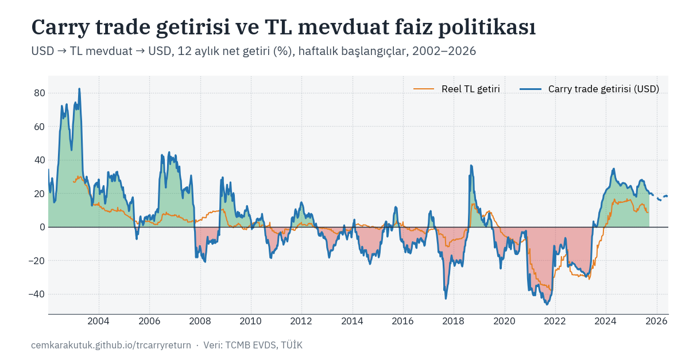

# Carry Trade Returns and TL Deposit Rate Policy

**Live site: [cemkarakutuk.github.io/trcarryreturn](https://cemkarakutuk.github.io/trcarryreturn/)** · Türkçe ve İngilizce · *Site is bilingual (TR/EN); use the language button in the top-right corner.*

An interactive, open-data study of how much return was paid on Turkish lira deposits — measured in foreign currency terms — to shift resident savers out of FX and FX-protected (KKM) deposits and to attract foreign carry trade inflows.

The measure is the **net return, in the original currency, of foreign exchange converted into TL deposits**, after withholding tax and exchange rate movement. Weekly, from January 2002 to the present (1,291 observations as of the latest update).



## What the site does

The main chart plots, for every start week since 2002, the 12-month net carry trade return realised over the following year. Each point answers a single question: if an investor had converted foreign currency into TL deposits that week, what would they have had twelve months later, back in the same currency?

Everything below the chart is configurable:

| Setting | Options |
| --- | --- |
| Base currency | USD, EUR, GBP, gold (TL/gram) |
| TL rate series | Total (all maturities), up to 1 / 3 / 6 months, up to 1 year, 1 year and longer |
| Term (rollover) | 1, 3, 6 months, 1 year, longer — shown only for the total series |
| Withholding tax | Rates in force at the time, a fixed rate, or gross (no tax) |
| Inflation measure | CPI (TÜFE) or domestic PPI (Yİ-ÜFE) |
| Display | FX spread, TL nominal return, real TL return, FX change, policy rate, event markers |

Clicking a week — or zooming into a range — opens a period analysis with cumulative and annualised returns, the closing value, the FX move, total withholding tax paid, and a deposit-by-deposit breakdown of interest, tax and balance. Chart data and the combined dataset can be downloaded as CSV.

## Method

Interest accrues on each deposit as `balance × annual rate × days / 365` and is rolled over at the rate prevailing in the week the deposit is renewed. The withholding tax rate in force on the date the deposit is opened or renewed is deducted from gross interest, using the bracket that matches the selected term. With the FX spread enabled, entry uses the CBRT foreign exchange **buying** rate and exit uses the **selling** rate.

The default view applies the total deposit rate (`TP.TRY.MT06`) annually: a single 52-week deposit opened at the start week's rate, with interest accruing once at maturity.

Real returns are `(1 + nominal TL return) ÷ (1 + period inflation) − 1`. Periods shorter than 52 weeks are annualised as `(1 + r)^(52/h) − 1`; the main chart shows only periods of at least 13 weeks, because exchange rate volatility inflates annualised figures over very short windows.

Full methodology, assumptions and limitations are documented on the site.

### Why deposit rates rather than TLREF

TLREF, commonly used in institutional carry trade models, has no history before 2018/2019. To extend the series back to the early 2000s and compare different macroeconomic regimes, this study uses the CBRT's weighted-average TL deposit rates (`TP.TRY.MT` series) instead. These capture both the actual opportunity cost faced by residents deciding whether to switch out of FX and KKM deposits, and the cash carry dynamics realised through deposit liabilities in the financial account of the balance of payments.

## Context: deposit dollarisation

The chart below shows why the question matters. Foreign currency deposits held between 40% and 55% of total deposits for most of the 2010s, peaked above 70% in mid-2022 once FX-protected deposits (KKM) are counted, and have since fallen back to around 39%. The period in which carry returns turned sharply negative — 2021 through mid-2023 — is the same period in which dollarisation accelerated.


*FX deposits are converted at their TL equivalent; KKM data begin in February 2022. Banking sector total (groups 2+5+8). Source: BDDK. Last observation: 11 September 2026.*

## Data sources

| Series | Source | Frequency |
| --- | --- | --- |
| TL deposit rates, `TP.TRY.MT01`–`MT06` | CBRT EVDS | Weekly |
| USD / EUR / GBP buying and selling rates | CBRT EVDS | Weekly |
| CPI (`TP.GENENDEKS.T1`), domestic PPI (`TP.TUFE1YI.T1`) | TurkStat, via CBRT EVDS | Monthly |
| Policy rate (`TP.BISPOLFAIZ.TUR`) | BIS, via CBRT EVDS | Monthly |
| Gold, XAU/TRY per gram (close) | ICE, via TradingView | Weekly |
| Withholding tax rates | Council of Ministers and Presidential decisions, Official Gazette | 12 regimes since 2002 |

## Repository layout

```
index.html                       Site
assets/css/styles.css            Styling
assets/js/app.js                 Calculation engine, charts, bilingual UI
assets/og-preview.png            Social preview image
data/dataset.json                Processed dataset the site reads
data/dataset.csv                 Same data as CSV
data/events.json                 Event markers on the chart
data/raw/                        Source files (see below)
scripts/update_data.py           Builds dataset.json and dataset.csv from data/raw/
.github/workflows/               Regenerates the dataset when data/raw/ changes
```

## Updating the data

Upload the refreshed file(s) to `data/raw/`. A GitHub Actions workflow regenerates `dataset.json` and `dataset.csv` and publishes the site automatically — nothing needs to be run locally.

| File | Contents | Cadence |
| --- | --- | --- |
| `weekly` | EVDS: `TP.TRY.MT01`–`MT06`, USD/EUR/GBP buying and selling rates | Weekly |
| `monthly` | EVDS: CPI, domestic PPI, policy rate | Monthly |
| `gold` | TradingView XAU/TRY weekly bars (the `close` column is used) | Weekly |
| `stopaj` | Withholding tax schedule | When rates change |

File names only need to start with these words; `.xlsx` and `.csv` are both accepted. Rows dated after the update date — an unfinished week or month — are dropped automatically.

To rebuild locally instead:

```bash
pip install pandas openpyxl
python scripts/update_data.py
```

## Notes and limitations

Deposit rate series are flow-based weighted averages across banks, so the rate an individual investor obtains may differ. Transaction taxes on foreign currency purchases and bank fees are not modelled, and bank spreads are typically wider than the CBRT spread used here. EVDS weekly exchange rates are downloaded as weekly averages, so entry and exit rates can deviate from actual transaction rates, most visibly in weeks of currency shocks. The policy rate series is monthly and end-of-month, so each week shows the rate in force at the start of its month; it is displayed for context only and does not enter any calculation.

## License

MIT — see [LICENSE](LICENSE). The underlying data belongs to its respective publishers.

## Contact

Cem Karakutuk · [cemkarakutuk@hotmail.com](mailto:cemkarakutuk@hotmail.com)

This project is for academic purposes and does not constitute investment advice.
